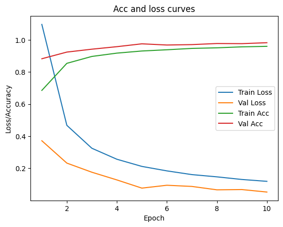

## The problem

Spotting plant diseases early matters for yields, and a photo of a leaf is often enough for an expert. The question was how well a convolutional network trained from scratch can do the same across 38 categories of healthy and diseased leaves from 14 crops in the PlantVillage dataset.

## What I built

- A **stacked CNN** in PyTorch: blocks of 3×3 convolutions followed by fully connected layers with dropout, trained from scratch on 224×224 images.
- **Training** with Adam and cross-entropy for up to 10 epochs, keeping the checkpoint with the best validation accuracy (with early stopping).

## Result

After 10 epochs the model reached 98.28% accuracy on the validation images, with precision 98.30%, recall 98.28% and F1 98.27%.

## Limits

The same validation split was used to choose the checkpoint and for the final scores, so the numbers are slightly optimistic; a separate test split would give a cleaner estimate. PlantVillage photos are taken against plain backgrounds, so accuracy on photos taken in a field would be lower.
