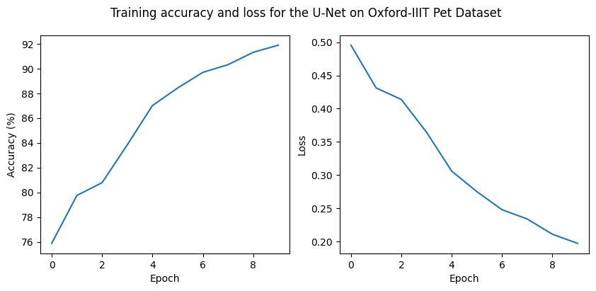

## The problem

Semantic segmentation labels every pixel of an image. Here the task is binary: pet or background, on the Oxford-IIIT Pet dataset.

## What I built

- A **U-Net** in PyTorch: an encoder that compresses the image, a decoder that expands it back to full size, and skip connections that carry fine detail across.
- A **data pipeline** that resizes images and masks to 128×128 (bilinear for images, nearest-neighbour for masks so labels stay crisp) and turns the dataset's three-way trimaps into binary masks.
- Training with binary cross-entropy and Adam for 10 epochs, with plots of the predictions.

## Result

Pixel accuracy on the training images rose from 75.9% after the first epoch to 91.9% after the tenth, with the loss still falling.

.")

## Limits

The accuracy above is measured on the training images; the notebook does not score a held-out test split. The predicted masks get the overall shape right but blur edges and leak into similar-looking background, which more epochs, augmentation and a Dice or IoU metric would address.
