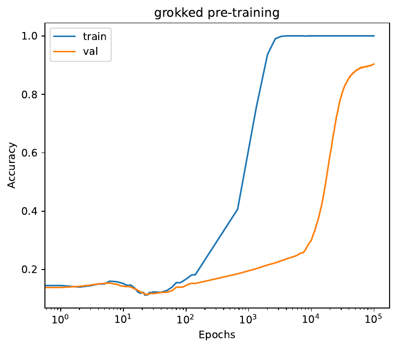
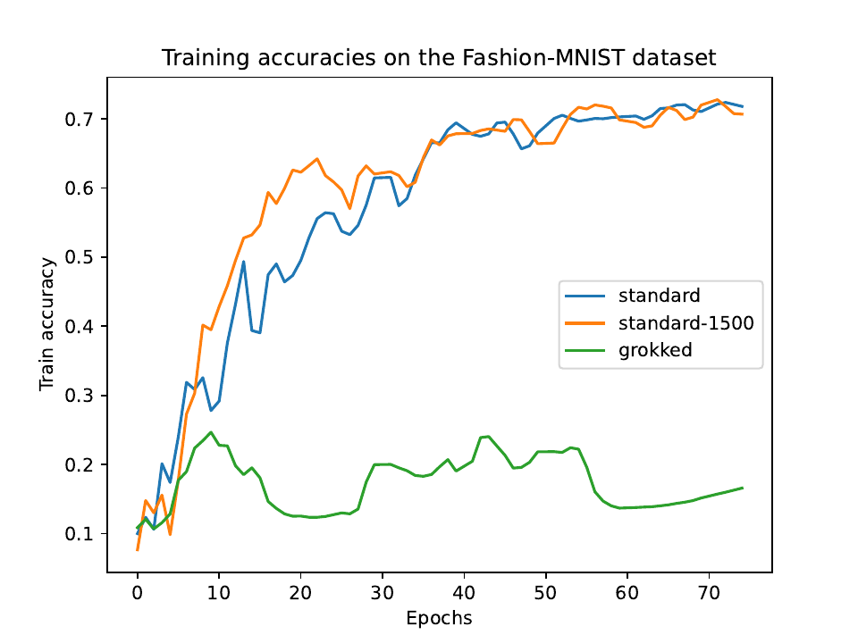

## Overview

Grokking improves a network's accuracy on the task it was trained on, but what does it do to its ability to learn something new? This paper uses transfer learning as a probe. The same small MLP was pre-trained on MNIST three ways: standard training on all 60,000 images, standard training on 1,500 images, and grokking-inducing training on those 1,500 images with large initial weights. Each model was then fine-tuned on Fashion-MNIST with identical settings.

## Results

The grokked model was the best on MNIST, with 100% training and 90.4% validation accuracy. It was also by far the worst at adapting: after fine-tuning on Fashion-MNIST it reached about 16.5% validation accuracy, while the two standard models reached about 71% and 70%.

Analyses of the weight changes, the loss landscape and the eigenvalue spectrum of the loss Hessian point to the same cause: the grokked model sits in a flatter region of the loss surface and its weights barely move during fine-tuning, so grokking appears to buy accuracy on the source task at the cost of flexibility. For an overview of grokking itself, see the [review](/research/grokking-review/).
