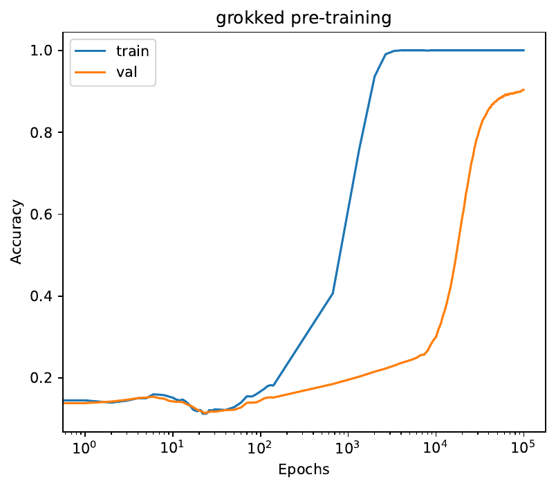
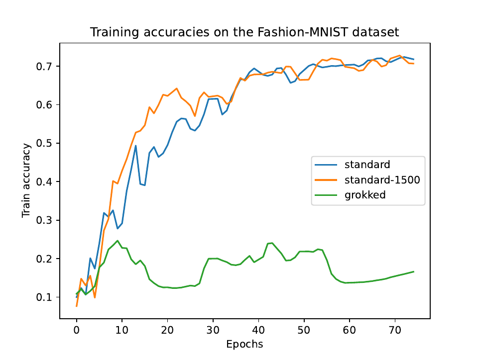

## The question

Grokking is a training dynamic in which a network first memorises its training data and then, after much longer training, suddenly generalises. It improves performance on the task it was trained on, but what does it do to the network's ability to learn something new? My master's thesis at [VIT Bhopal](/experience/#vit-bhopal) used transfer learning as a probe.

## What I did

- Pre-trained the same small MLP (784 → 200 → 200 → 10) on MNIST three ways: standard training on all 60,000 images for 25 epochs; standard training on 1,500 images; and grokking-inducing training on those 1,500 images with large initial weights (scaled 8×) for 100,000 epochs.
- Fine-tuned each model on Fashion-MNIST for 75 epochs with identical settings, and measured how well each adapted.
- Analysed why, with weight-change visualisations, loss-landscape contour plots and the eigenvalue spectrum of the loss Hessian.

## Result

The grokked model was the best on MNIST (100% training and 90.4% validation accuracy, against 86.3% and 82.6% for the two standard models), and by far the worst at adapting: after fine-tuning on Fashion-MNIST it reached about 16.5% validation accuracy, while the standard models reached about 71% and 70%.

The grokked model's weights barely changed during fine-tuning, and its Hessian spectrum had more eigenvalues near zero: a flatter loss surface that leaves little room to move. Grokking appears to buy source-task accuracy at the cost of flexibility.

## Publications

The thesis led to two papers: a [review of grokking](/research/grokking-review/) in *SN Computer Science* (2025) and the [rigidity analysis](/research/grokking-rigidity/), at ICDAM 2025. All my papers are on the [Research](/research/) page.
